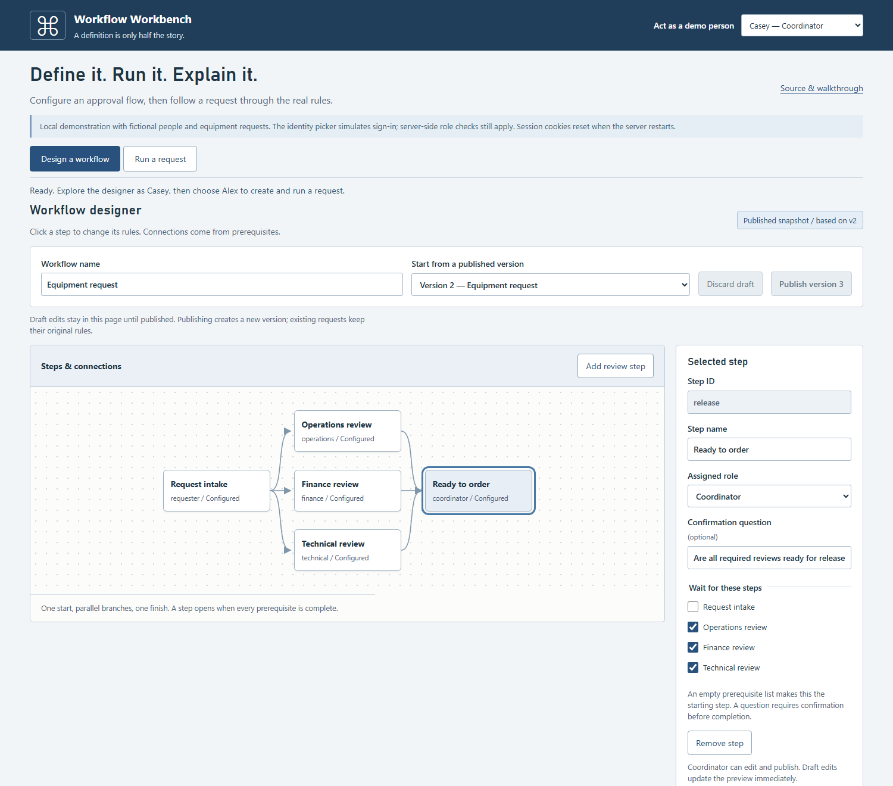
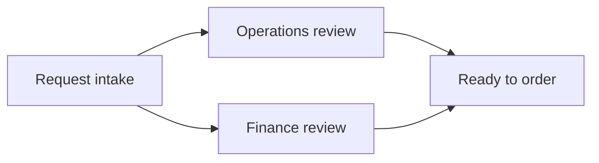
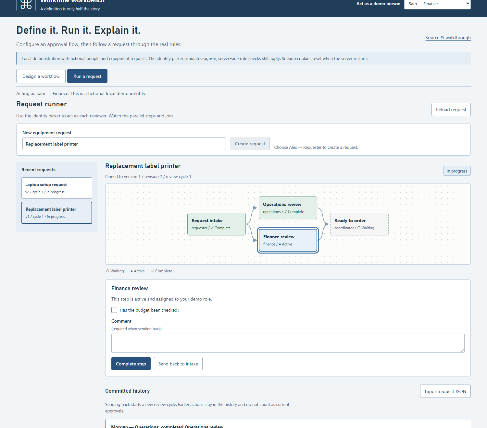

# Workflow Workbench

[](https://github.com/PatrickSchaller/workflow-workbench/actions/workflows/verify.yml)

**Configure an approval workflow. Publish its rules. Run a request through it.**

A small .NET application demonstrating the design behind configurable business workflows: visual setup, parallel reviews, prerequisite gates, role checks, required confirmations, send-back cycles, immutable versions and durable history.

This independently written portfolio example demonstrates general concepts from internal business-system work. All identities and requests are invented. No employer engine, configuration, UI, data or connected services are included.



## Run it

Requires a patched [.NET 10 SDK](https://dotnet.microsoft.com/download/dotnet/10.0). The browser UI is plain HTML/CSS/JavaScript, with no frontend build or framework installation.

```sh
dotnet restore WorkflowWorkbench.sln --locked-mode
dotnet run --project src/WorkflowWorkbench
```

Open **http://127.0.0.1:5099**. A new database starts with this equipment-request definition:



Both review steps become active after intake. The final step opens only after **both** reviews complete. Assignment, prerequisite and question checks are enforced on the server.

The default SQLite database is `src/WorkflowWorkbench/data/workbench.db`. It survives restart and is never automatically reset. To choose another path, set `Workbench__DatabasePath` before starting the app. An unrelated or unsupported database is rejected before schema changes.

## Five-minute walkthrough

1. **Inspect the designer as Casey — Coordinator.** Click a graph node. Its assigned role, prerequisite checkboxes and optional confirmation question appear in the inspector. Draft edits update the preview immediately and stay in the page until published.
2. **Run a request.** Open **Run a request**, choose **Alex — Requester**, and create “Replacement label printer.” Confirm the intake question and complete the step. Operations and Finance both become active.
3. **Try a partial approval.** Choose **Morgan — Operations** and complete Operations review. The final step stays waiting for Finance. Another role cannot complete the Operations step.
4. **Send it back.** Choose **Sam — Finance**, enter a reason and select **Send back to intake**. A new review cycle starts. Earlier approvals remain in history but no longer satisfy current prerequisites. Resubmit as Alex and complete the two reviews again.
5. **Change future rules.** As Casey, return to the designer and add a review step. Keep its Technical role and intake prerequisite. Select the final step and check the new review as an additional prerequisite. Publish version 2. The existing request remains on version 1; a new request uses version 2 and needs all three reviews.
6. **Finish and inspect.** Casey can complete the final step after every review. Reload the request or export JSON to inspect its pinned definition, revision, cycle, step states and committed history.



The screenshots show actual application state created through the API. [Captured walkthrough JSON](docs/walkthrough.json) includes a version 1 request with one completed review and a version 2 request with three active branches.

## What this demonstrates

| Behavior | Why it matters |
| --- | --- |
| Editable graph and inspector | Definitions are data. Adding a review does not add a hard-coded controller action. |
| Immutable published versions | Editing the process does not quietly rewrite rules for work already in progress. |
| Fan-out and AND-join | Reviewers can work in parallel while the next step waits for every prerequisite. |
| Role and question checks | A visible button is not the authorization boundary. The server validates each action. |
| Send-back cycle | Rework preserves history and resets all current approvals, preventing an earlier approval from leaking into a new cycle. |
| Atomic state and history | A transition and its history commit together; an injected history failure rolls back the already-written state. |
| Revision and command identity | Concurrent stale actions cannot both commit. Repeated matching commands do not repeat an action; a changed command payload is rejected. |

## Structure

- `Engine.cs`: definition validation and pure transition rules.
- `WorkbenchStore.cs`: SQLite versions, instances and history; transaction boundaries and repeated-command handling.
- `Program.cs`: HTTP endpoints, local-only boundary and cookie/role policies.
- `MemoryKeyRepository.cs`: supported data-protection repository interface with process-local key storage; no shared user key-directory access.
- `wwwroot/graph.js`: dependency-based graph layout and keyboard-focusable step buttons.
- `wwwroot/app.js`: draft editing, version publication, actor selection and request execution.

Read the [code walkthrough and decisions](docs/code-walkthrough.md) and [validation record](docs/validation.md).

## Verify

```sh
dotnet test WorkflowWorkbench.sln -c Release
dotnet publish src/WorkflowWorkbench -c Release -o artifacts/app
```

For browser tests, also install Node.js 22 or later:

```sh
npm ci --ignore-scripts
npx playwright install chromium
npm test
```

Stop any manually running workbench first. The browser suite starts its own server with a new, ignored database under `artifacts/`. Tests create synthetic requests and publish versions in that scratch database. GitHub Actions runs .NET build/test/publish on Windows and Linux, plus the full Chromium walkthrough on Linux.

To reproduce documentation screenshots, run the app against a **new** scratch database and use `npm run screenshots`. The script intentionally refuses a database that already has several versions. It creates its samples through the API and does not reset or delete existing requests.

## Scope and limits

- **Local demonstration.** The app binds to loopback and rejects non-local peers and unexpected Host headers. Write requests require a custom header; no CORS policy is enabled. API bodies are limited to 64 KiB.
- **Demo identities.** The local picker lets anyone at this app select a fictional actor, including the coordinator. This is intentional simulation, not production authentication. The server derives actors from a protected HttpOnly, SameSite cookie, not an action-body role. Cookie keys live only in memory; restarting expires sessions while SQLite request data remains. Replace the identity picker with a real identity provider before any shared deployment.
- **Bounded graph.** Two to ten steps, one start, one finish, an acyclic dependency graph, one role and at most one confirmation question per step. Layout is automatic. This is not a drag-and-drop diagram tool or a general scripting engine.
- **Explicit rework rule.** Send back restarts the whole request at intake. There is no selective branch rollback, optional/conditional path language or migration of active instances between versions.
- **Local transaction boundary.** No emails, ERP updates, remote effects, compensation handlers or background delivery are implemented. A SQLite rollback is not a distributed rollback guarantee.
- **History and drafts.** History is append-only through the application, not tamper-evident against a database editor. Unpublished drafts are browser-memory state and disappear on reload; published versions are durable. The UI lists the most recent 50 versions and requests.

Implementation was created with AI assistance. The example is intended to be reviewed, explained and extended; no production workload, compliance certification or measured business outcome is claimed.

MIT licensed.
